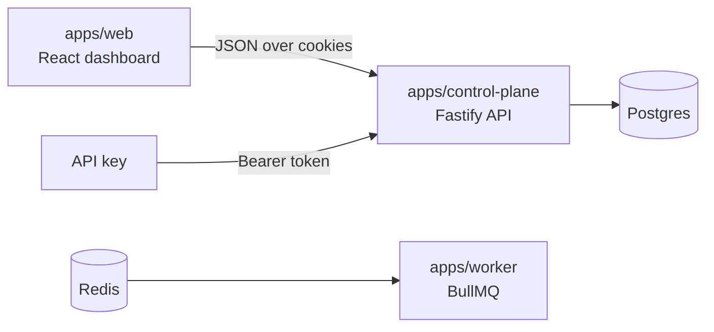

# Shipyard

Shipyard is the start of a deployment platform: a control plane API, a job worker and a web dashboard in one pnpm monorepo. You register, get a team, create an API key and a project, and manage who is on the team.

It was built in March 2026. Accounts, sessions, teams, invitations, roles, onboarding and API keys are in. Builds and deployments exist as database tables and job types.

## What is here

- 15 HTTP routes on Fastify: health, register, login, logout, current session, four onboarding steps, projects, and team members with invitations, role changes and removal.
- 19 Postgres tables through Drizzle, with 3 committed migrations. They cover users, sessions, teams, memberships, invitations, API keys, projects, env vars, source artifacts, builds, build logs, deployments, routes, events, metrics, usage and billing.
- Four team roles: owner, admin, operator, viewer.
- A BullMQ worker on Redis with four typed jobs: noop, build, reconcile, billing.
- A React dashboard with sign in, registration, guided onboarding, a projects list and team management.
- 80 tests in Vitest. 78 run without services. 2 worker tests need Redis.
- About 6,500 lines of TypeScript source and 3,800 lines of tests.

## How it works



Passwords are hashed with argon2id. A session is sent as an HTTP-only cookie. API keys are shown once and stored hashed, with a short prefix for lookup. Every request body and response is validated against a JSON schema, and every error comes back in one shape: `{ ok: false, error: { code, message, statusCode } }`.

Onboarding is a small state machine: confirm the team, create the first API key, create the first project. The server decides the current step from what is stored, so a page reload lands in the right place.

## Layout

```
apps/
  control-plane/   Fastify API: auth, teams, onboarding, API keys
  web/             React 19, React Router, TanStack Query, Vite
  worker/          BullMQ worker and job types
packages/
  config/          typed environment loaders (zod)
  db/              Drizzle schema, migrations, migration runner
  ui/              Button, Card, Input, Badge, Table, Dialog, EmptyState
infra/
  helm/            placeholder workspace
  terraform/       placeholder workspace
scripts/           workspace validation run before every task
compose.yaml       Postgres 17, Redis 7, MinIO for local development
```

## Setup

You need Node 25, pnpm 10 and Docker.

```sh
pnpm install
cp .env.example .env        # fill in the three passwords
docker compose up --wait postgres redis minio
pnpm db:migrate
```

Run the three processes:

```sh
pnpm --filter web dev
pnpm --filter @shipyard/worker start
set -a
source .env
set +a
(cd apps/control-plane && pnpm exec tsx -e "import('./src/index.ts').then((m) => m.default.startControlPlane())")
```

Checks:

```sh
pnpm lint
pnpm typecheck
pnpm test
pnpm build
```

## Environment variables

| Variable | Used for |
| --- | --- |
| `POSTGRES_DB`, `POSTGRES_USER`, `POSTGRES_PASSWORD` | the local Postgres container |
| `MINIO_ROOT_USER`, `MINIO_ROOT_PASSWORD` | the local MinIO container |
| `DATABASE_URL` | Postgres connection for the API, worker and migrations |
| `REDIS_URL` | job queue |
| `S3_ENDPOINT`, `S3_REGION`, `S3_BUCKET` | object storage location |
| `S3_ACCESS_KEY_ID`, `S3_SECRET_ACCESS_KEY` | object storage credentials |
| `S3_FORCE_PATH_STYLE` | `true` for MinIO |

## Status

Work stopped on 9 March 2026, partway through the API key story. This is published as it was and is not maintained.

## Licence

[MIT](LICENSE). Free to use, change, self-host and build on, including commercially.

Thanks to Fastify, Drizzle, BullMQ, Vite, React, TanStack Query and Turborepo.
